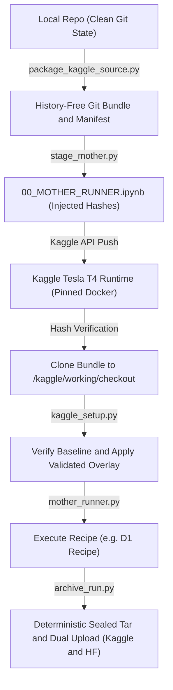
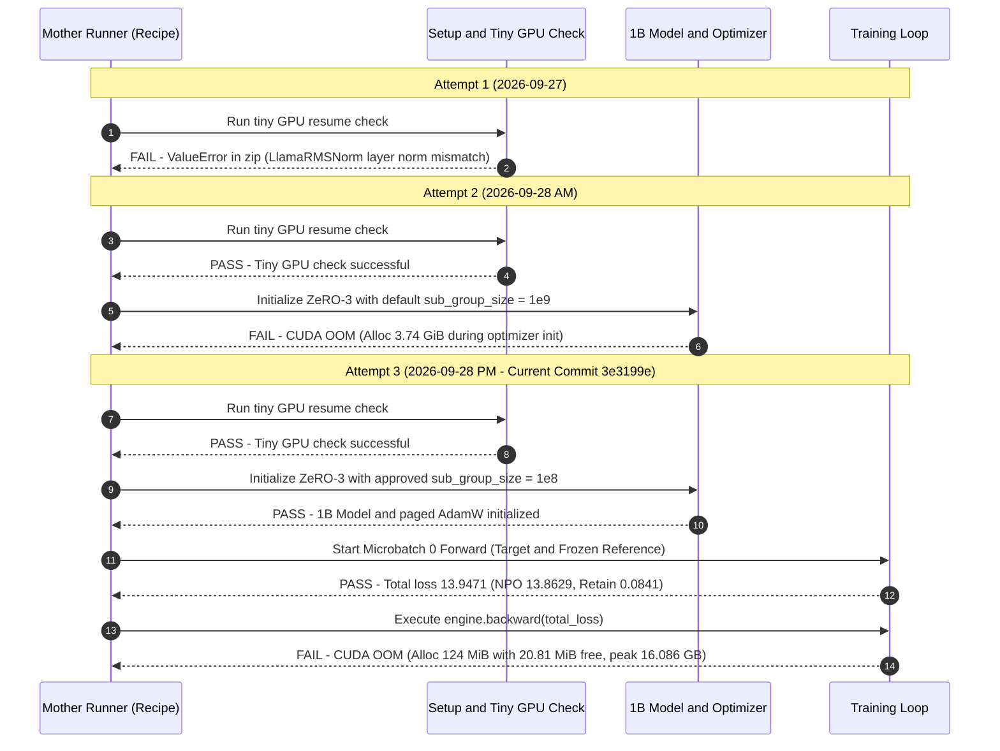

# FQ-SSIUU: Master Architectural Audit, Dependency Reproducibility Analysis, and Execution Guide

**Project Title:** Verifiable Machine Unlearning Against Quantisation Recovery Attacks in Large Language Models (FQ-SSIUU)  
**Authors:** Muhammad Arslan & Rohan Ahmed (Department of Artificial Intelligence, MUET Jamshoro)  
**Repository Working Directory:** `/home/muhammad-arslan/Downloads/projects/fq-ssiuu`  
**Current Target Branch:** `repro/npo-1b-source-faithful` @ commit `3e3199e` (see [Work Unit D1 Report](handbook/reports/WORK_UNIT_D1_REPORT.md))  
**Dev Lineage Base:** `dev` @ commit `6be1c5e` (incorporating PR #10 `5ca92bf` and PR #11 `3e3199e`)  
**Evidence Standard:** [Verified] (authoritative in current tracked code/logs), [Inferred] (derived from mechanics), [Historical] (superseded / archived), [Proposed] (forward recommendations).

---

## 1. Executive Summary & Research State

### 1.1 The Research Mission & Core Hypothesis

Large Language Model (LLM) machine unlearning seeks to permanently erase sensitive data, copyright material, or private identities (e.g. TOFU fictitious author profiles) from fine-tuned models without degrading general utility. However, standard unlearning evaluations assess models in floating-point representations (FP16 or BF16).

The central scientific premise of **FQ-SSIUU** is:

> Standard unlearning creates "surface-level" erasure in high-precision weights. When unlearned models undergo post-training quantisation (PTQ) into low-bit representations (e.g., INT8, INT4, NF4) or quantisation-aware fine-tuning (QAT), the quantisation noise shifts the weight landscape, leading to **Quantisation Recovery Attacks (QRA)** that recover supposedly forgotten information.
>
> **FQ-SSIUU** addresses this vulnerability by combining **Fake Quantisation (FQ-QAT)** during unlearning with **Selective Salience-Informed Unlearning (SSIUU)** and logit-margin loss (**QUAIL**) to produce verifiable unlearning that remains provably durable across low-precision deployment formats.

### 1.2 Current Development Level & Operational Gates

The project enforces strict operational and research gates recorded in [`handbook/operational_gates.yaml`](handbook/operational_gates.yaml) and [`handbook/PROJECT_STATUS.md`](handbook/PROJECT_STATUS.md):

| Gate / Work Unit     | Scope / Objective                                                                                                                     | Current Status                            | Key Evidence / Output                                                                      |
| :------------------- | :------------------------------------------------------------------------------------------------------------------------------------ | :---------------------------------------- | :----------------------------------------------------------------------------------------- |
| **GATE-0 (OG-000)**  | Kaggle T4 runtime environment baseline audit (Python 3.12.13, PyTorch 2.10.0+cu128, CUDA 12.8).                                       | **CLOSED / PASSED** [Verified]            | [`gate0_kaggle/...`](handbook/evidence/gate0_kaggle/57588774-bdd5-41c8-b56e-7df0c2f5049b/) |
| **OG-001**           | Kaggle overlay dependency validation & non-regression proof (installing bitsandbytes 0.46.1, peft, lm-eval without corrupting torch). | **CLOSED / PASSED** [Verified]            | [`og001_kaggle/...`](handbook/evidence/og001_kaggle/20260906_kernel_v4_2be46116/)          |
| **Work Unit B**      | Non-model orchestration harness test (Mother Runner lifecycle, bundle verification, recipe dispatcher).                               | **CLOSED / PASSED** [Verified]            | [`work_unit_b/...`](handbook/evidence/work_unit_b/20260922_attempt1_318e523a/)             |
| **Work Unit C**      | Four-example forward-only method boundary check (adapter encoding, TOFU splits, NPO loss formulation).                                | **CLOSED / PASSED** [Verified]            | [`work_unit_c/...`](handbook/evidence/work_unit_c/20260924_attempt2_14669f3/)              |
| **Work Unit D1**     | Source-faithful 1B NPO unlearning pilot (`open-unlearning/tofu_Llama-3.2-1B-Instruct_full` on single Tesla T4).                       | **PAUSED / FAILED ACCEPTANCE** [Verified] | Attempt 3 backward OOM (`torch.cuda.OutOfMemoryError`). Paused at `3e3199e`.               |
| **RG-001 to RG-006** | Scientific research gates (NPO reproduction, QRA evaluation, SSIUU attribution, FQ-QAT, Confirmatory Protocol v2).                    | **BLOCKED ON D1**                         | Downstream gates cannot proceed until the 1B unlearning baseline is trained or adapted.    |

---

## 2. Repository Software Architecture

### 2.1 Active Packages vs. Research Implementations

A foundational design principle established across recent pull requests is the strict separation between reusable operational infrastructure and scientific method code:

1. **`src/fq_ssiuu/` (Reusable Core Infrastructure)** [Verified]:
   - [`src/fq_ssiuu/environment.py`](src/fq_ssiuu/environment.py): Platform detection (Kaggle vs. Colab vs. Local), hardware probes, GPU telemetry.
   - [`src/fq_ssiuu/secrets.py`](src/fq_ssiuu/secrets.py): Three-tier zero-leak secret loader (`os.environ` → Kaggle Secrets → in-memory `.env`).
   - [`src/fq_ssiuu/models/loader.py`](src/fq_ssiuu/models/loader.py): HuggingFace / BitsAndBytes model and tokenizer loaders.
   - [`src/fq_ssiuu/evaluation/qra_pipeline.py`](src/fq_ssiuu/evaluation/qra_pipeline.py): Standardized Quantisation Recovery Attack evaluation and metric contracts.
   - _Note:_ No experimental training loops reside in `src/fq_ssiuu/`.

2. **`experiments/reproductions/` (Method-Specific Research Code)** [Verified]:
   - `NPO/`: Active source-faithful implementation of Negative Preference Optimization.
   - `QRA/`: Quantisation Recovery Attack protocols, KS tests, and probability evaluation metrics.
   - `QUAIL/`: Mishra & Mehreen (2026) logit-space hinge unlearning loss baseline.
   - `SSIUU/`: Selective Salience-Informed Unlearning (Integrated Gradients & Gradient Norm attribution).
   - `FQ_QAT/`: Fake-Quantised Quantisation-Aware Training wrappers for LoRA adapters.
   - `historical/` subdirectories: Archive earlier August Colab pilots (`pilot_p1.py` through `pilot_p4.py`).

### 2.2 The Mother Runner Execution Lifecycle

To prevent untracked state mutations and notebook pollution on Kaggle, all remote execution follows the **Mother Runner Pattern**:



```text
+--------------------------------------------------------------------------+
|                       MOTHER RUNNER EXECUTION FLOW                       |
+--------------------------------------------------------------------------+
| [Local Workstation]                                                      |
|   1. Clean Git Tree Verification                                         |
|   2. scripts/package_kaggle_source.py -> fq-ssiuu-source.bundle          |
|   3. scripts/stage_mother.py          -> Inject hashes into Cell 1       |
|   4. kaggle kernels push              -> Upload staged notebook          |
+--------------------------------------------------------------------------+
                                     |
                                     v
+--------------------------------------------------------------------------+
| [Kaggle Tesla T4 Runtime: Pinned Docker]                                 |
|   5. Cell 2: Verify bundle SHA-256 and snapshot tree commit              |
|   6. Clone bundle to /kaggle/working/checkout-[run_id]                   |
|   7. scripts/kaggle_setup.py: Verify baseline & apply validated overlay  |
|   8. scripts/mother_runner.py: Dispatch requested recipe JSON            |
|   9. scripts/archive_run.py: Create sealed artifacts.tar & verify hashes |
|  10. Dual Mirror: Synchronize to private Kaggle and Hugging Face datasets|
+--------------------------------------------------------------------------+
```

1. **Packaging ([`scripts/package_kaggle_source.py`](scripts/package_kaggle_source.py))**:
   - Inspects the committed git tree. Runs regex secret scanning for HuggingFace tokens, GitHub PATs, private keys, and AWS credentials.
   - Creates a single parentless commit in `fq-ssiuu-source.bundle` and outputs `SOURCE_MANIFEST.json` with cryptographic SHA-256 hashes.
2. **Staging ([`scripts/stage_mother.py`](scripts/stage_mother.py))**:
   - Verifies the working tree is clean. Injects literal commit, tree, and manifest hashes into Cell 1 of [`notebooks/kaggle/00_MOTHER_RUNNER.ipynb`](notebooks/kaggle/00_MOTHER_RUNNER.ipynb).
   - Generates `kernel-metadata.json` specifying the pinned Kaggle environment:
     `gcr.io/kaggle-private-byod/python@sha256:37c64f7dd9c54116ecd1bcc88817c5469b88387388fade02bfa8bf3fc647d461`.
3. **Execution ([`scripts/mother_runner.py`](scripts/mother_runner.py))**:
   - Dispatches the requested recipe (`configs/runs/*.json`).
   - Manages subprocess timeouts, isolates stdout/stderr streams, and enforces the single-GPU constraint (`CUDA_VISIBLE_DEVICES=0`).
4. **Archival & Sealing ([`scripts/archive_run.py`](scripts/archive_run.py))**:
   - Recursively hashes all artifacts. Rejects any forbidden paths (`.git`, `.env`, `.docx`, `.pem`).
   - Packages outputs into `artifacts.tar` and generates SHA-256 agreement receipts across private Kaggle and Hugging Face datasets.

### 2.3 Comprehensive Notebook Inventory (19 Notebooks Audited)

Every notebook across the repository was classified:

- **Active Operational Notebook (1):**
  - [`notebooks/kaggle/00_MOTHER_RUNNER.ipynb`](notebooks/kaggle/00_MOTHER_RUNNER.ipynb): The single active entry point for Kaggle T4 execution.
- **Historical Archived Notebooks (6 in `notebooks/kaggle/archive/`):**
  - [`EXPERIMENT_RUNNER.ipynb`](notebooks/kaggle/archive/EXPERIMENT_RUNNER.ipynb), [`GATE1_evaluation.ipynb`](notebooks/kaggle/archive/GATE1_evaluation.ipynb), [`PILOT_P1_P2.ipynb`](notebooks/kaggle/archive/PILOT_P1_P2.ipynb), [`PILOT_P3_P4.ipynb`](notebooks/kaggle/archive/PILOT_P3_P4.ipynb), [`GATE0_KAGGLE_ENV_AUDIT.ipynb`](notebooks/kaggle/archive/gate0_environment_audit/GATE0_KAGGLE_ENV_AUDIT.ipynb), [`OG001_KAGGLE_OVERLAY_VALIDATION.ipynb`](notebooks/kaggle/archive/og001_overlay_validation/OG001_KAGGLE_OVERLAY_VALIDATION.ipynb). Replaced by recipe-driven Mother Runner.
- **Evidence Run Artifacts (9 in `handbook/evidence/`):**
  - Bit-for-bit records of submitted notebooks from Gate-0, OG-001 (kernels v2, v3, v4), Mother Runner v1, Work Unit B, Work Unit C, and Work Unit D1 (Attempts 2 and 3).
- **Temporary Staging Snapshots (3 in `tmp/d1/`):**
  - Local staging intermediate files from D1 repairs.

---

## 3. Dependency Reproducibility & Environment Architecture

### 3.1 The Decoupled Overlay Architecture

Kaggle environments contain pre-installed, system-level PyTorch stacks linked to CUDA driver runtimes. Naive `pip install` commands frequently downgrade PyTorch or install incompatible CUDA wheels.

FQ-SSIUU implements the **Decoupled Overlay Architecture** ([`requirements/README.md`](requirements/README.md)):

- **Protected Native Baseline ([`requirements/kaggle-native-baseline.json`](requirements/kaggle-native-baseline.json))**:
  - Python `3.12.13`, CUDA `12.8`, Driver `580.159.04`.
  - Immutable packages: `torch==2.10.0+cu128`, `torchvision==0.25.0+cu128`, `torchaudio==2.10.0+cu128`, `triton==3.6.0`.
  - Prohibits any installation or upgrade that mutates these core compute libraries.
- **Validated Research Overlay ([`requirements/kaggle-overlay.validated-0461.lock`](requirements/kaggle-overlay.validated-0461.lock))**:
  - Installs: `bitsandbytes==0.46.1`, `peft==0.18.1`, `transformers==5.0.0.dev0`, `lm-eval==0.4.13`, `optimum`, `evaluate`, and support libraries.
  - Verified by [`scripts/kaggle_setup.py`](scripts/kaggle_setup.py) and [`scripts/verify_kaggle_env.py`](scripts/verify_kaggle_env.py) via dry-run dependency checks before execution.

### 3.2 Audit of Discrepancies & Missing Declarations

The dependency audit identified several non-obvious gaps across environments:

1. **`rouge-score` Runtime Dependency Gap:**
   - Imported by [`experiments/reproductions/QRA/metrics.py`](experiments/reproductions/QRA/metrics.py#L69).
   - Omitted from `pyproject.toml` and `kaggle-overlay.validated-0461.lock`. It only succeeded in Kaggle because Kaggle's base image happened to include `rouge_score==0.1.2`. Local environments and CI fail unless explicitly installed.
2. **`packaging` and `nbformat` Utility Gaps:**
   - Imported in [`scripts/kaggle_setup.py`](scripts/kaggle_setup.py), [`scripts/pip_consistency.py`](scripts/pip_consistency.py), and [`scripts/check_notebooks.py`](scripts/check_notebooks.py).
   - Missing from `[project.optional-dependencies]` in `pyproject.toml`.
3. **Hardware-Specific Omissions (Flash-Attention):**
   - Replaced permanently by PyTorch native **SDPA** (`attn_implementation="sdpa"`) via Decision Record [`handbook/decisions/DL-007_flash_attn_removal.md`](handbook/decisions/DL-007_flash_attn_removal.md). NVIDIA Tesla T4 is Turing (SM75), which does not support Flash-Attention 2.x.
4. **DeepSpeed Source Compilation Requirement:**
   - Work Unit D1 requires DeepSpeed ZeRO-3. In the Kaggle runtime, DeepSpeed must be compiled against torch 2.10.0 without CUDA kernel op builds (`DS_BUILD_OPS=0`).

---

## 4. Deep Dive: Work Unit D1 & The NPO Out-Of-Memory Failure

### 4.1 Work Unit D1 Specification

Work Unit D1 implemented an adapted reproduction of Negative Preference Optimization (Zhang et al., 2024) with Retain Regularization:

- **Base/Target Model:** `open-unlearning/tofu_Llama-3.2-1B-Instruct_full` (~1.24B parameters, FP16).
- **Frozen Reference Model:** Same 1B model, unquantized FP16, frozen on `cuda:0`.
- **Dataset:** TOFU benchmark (`forget05` split: 200 samples; `retain95` split: 3,800 samples).
- **Hardware Constraint:** Exactly 1 × NVIDIA Tesla T4 GPU (16,000,000,000 bytes hard limit; ~14.56 GiB usable VRAM).
- **Optimization Design:** DeepSpeed ZeRO-3 with `bitsandbytes.optim.PagedAdamW32bit`, learning rate 1e-5, sequence length 500.

### 4.2 Comparative Analysis of the Three Kaggle Attempts



```text
+-------------------------------------------------------------------------------------------------+
|                                 WORK UNIT D1 ATTEMPTS COMPARISON                                |
+-------------------------------------------------------------------------------------------------+
| Attempt 1 (2026-09-27):                                                                         |
|   Mother Runner -> Tiny GPU Resume Check -> [FAIL: ValueError in zip()]                         |
|   Root Cause: Transformers 5 RMSNorm module hierarchy mismatch.                                 |
+-------------------------------------------------------------------------------------------------+
| Attempt 2 (2026-09-28 AM):                                                                      |
|   Mother Runner -> Tiny GPU Check [PASS] -> ZeRO-3 Optimizer Init -> [FAIL: CUDA OOM 3.74 GiB] |
|   Root Cause: Default DeepSpeed sub_group_size = 1e9 created excessive param partitions.        |
+-------------------------------------------------------------------------------------------------+
| Attempt 3 (2026-09-28 PM, Commit 3e3199e):                                                      |
|   Mother Runner -> Tiny GPU Check [PASS]                                                        |
|                 -> ZeRO-3 Optimizer Init (sub_group_size = 1e8) [PASS]                          |
|                 -> 1B Target + Frozen Reference Loading [PASS]                                  |
|                 -> Microbatch 0 Forward [PASS] (Loss: 13.9471)                                  |
|                 -> engine.backward(total_loss) -> [FAIL: CUDA OOM]                              |
|   Root Cause: 1.24B candidate + 1.24B reference + seq_len 500 autograd activations on single T4.|
|   Memory Stats: Peak allocated 13.19 GiB, reserved 13.53 GiB, device sampled peak 16.086 GB.    |
+-------------------------------------------------------------------------------------------------+
```

1. **Attempt 1 (`20260927-130645-e8483bf31420`)**:
   - **Failure Point:** Pre-flight tiny synthetic model GPU resume test.
   - **Error:** `ValueError: zip() argument 2 is longer than argument 1`.
   - **Cause:** Upstream change in Transformers 5 altered layer norm module names, creating an asymmetry in parameter group creation.
2. **Attempt 2 (`20260928-062524-7118f1ae8d74`)**:
   - **Failure Point:** 1B Model Optimizer Initialization.
   - **Error:** `torch.OutOfMemoryError: Tried to allocate 3.74 GiB with only 3.58 GiB free`.
   - **Cause:** DeepSpeed ZeRO-3's default `sub_group_size = 1e9` instantiated optimizer parameter partitions that exceeded remaining VRAM when setting up 32-bit master weights for paged AdamW.
3. **Attempt 3 (`20260928-124613-efd94997a1e8` - Current Repository Head)**:
   - **Fix Applied:** Reduced `sub_group_size = 1e8` in [`configs/reproductions/NPO/d1_train_v2.json`](configs/reproductions/NPO/d1_train_v2.json).
   - **Milestones Cleared:**
     - Tiny GPU resume test passed bit-for-bit.
     - 1B DeepSpeed engine and paged AdamW optimizer initialized successfully.
     - Frozen full FP16 reference model loaded into VRAM.
     - Microbatch 0 forward pass completed successfully:
       - `npo_loss`: **13.8629**
       - `retain_loss`: **0.0841**
       - `total_loss`: **13.9471**
   - **Fatal Failure Point:** First backward pass at [`experiments/reproductions/NPO/training_loop.py:94`](experiments/reproductions/NPO/training_loop.py#L94) during `engine.backward(terms.total)`.
   - **Exact Error Traceback:**
     ```text
     File "experiments/reproductions/NPO/training_loop.py", line 94, in run_training
         engine.backward(terms.total)
     File "/usr/local/lib/python3.12/dist-packages/deepspeed/runtime/engine.py", line 3484, in backward
         loss.backward(**backward_kwargs)
     File "/usr/local/lib/python3.12/dist-packages/torch/_tensor.py", line 630, in backward
         torch.autograd.backward(...)
     torch.OutOfMemoryError: CUDA out of memory. Tried to allocate 124.00 MiB.
     GPU 0 has a total capacity of 14.56 GiB of which 20.81 MiB is free.
     Including non-PyTorch memory, this process has 14.54 GiB memory in use.
     Of the allocated memory 13.18 GiB is allocated by PyTorch, and 358.54 MiB is reserved.
     ```
   - **Memory Violations:**
     - Peak allocated: `14,163,470,336 bytes` (~13.19 GiB)
     - Peak reserved: `14,526,971,904 bytes` (~13.53 GiB)
     - Sampled device peak (NVML): **`16,086,401,024 bytes`** (exceeded the 16 GB hardware policy ceiling by 86.4 MB).

### 4.3 Why Full-Parameter 1B Training Breaks Single-T4 VRAM

The fundamental physics of Attempt 3's memory budget on a single 16 GB GPU:

1. **Target Candidate Weights (ZeRO-3 Partitioned):**
   - 1.24B parameters in FP16 = ~2.47 GB. Under single-GPU ZeRO-3, partitioning provides zero memory reduction because rank=0 must hold all parameters during layer forwards/backwards.
2. **Optimizer States (Paged AdamW32bit + Master Weights):**
   - FP32 master weights (4 bytes/param) + 1st momentum (4 bytes/param) + 2nd momentum (4 bytes/param) = 12 bytes/param ≈ ~14.8 GB. While paging offloads inactive states to host RAM, active working groups require ~3.5 to 4.5 GB of CUDA headroom.
3. **Frozen Reference Model:**
   - Unquantized FP16 reference model permanently allocated on CUDA: ~2.47 GB.
4. **Autograd Forward Activations:**
   - Holding dual forward computation graphs (sequence length 500 for both forget batch and retain batch) requires ~3.0 to 4.5 GB of activation tensors.
5. **The Backward Pass Peak:**
   - During `engine.backward()`, PyTorch must recompute activations (via gradient checkpointing) _while_ accumulating gradients and un-partitioning ZeRO weights. Total instantaneous memory demand reaches ~16.1 GB, causing an unavoidable OOM on a 14.56 GiB device.

---

## 5. Local Execution and Reproduction Guide

To audit or reproduce the repository pipeline locally up to the exact point of the Work Unit D1 failure:

### Step 1: Environment Setup & Local Dependencies

```bash
# 1. Clone repository and verify commit (if starting from scratch)
# git clone https://github.com/ibn-e-Muhammad/fq-ssiuu.git
# cd fq-ssiuu

# 2. Checkout the D1 target branch
git checkout repro/npo-1b-source-faithful
# Ensure HEAD is 3e3199e

# 3. Create isolated virtual environment (Python 3.11 or 3.12)
python3 -m venv .venv
source .venv/bin/activate

# 4. Install core editable package and audit dependencies
pip install --upgrade pip setuptools wheel
pip install -e .
pip install -r requirements/requirements-dev.txt
pip install rouge-score packaging nbformat  # Fill identified runtime gaps
```

### Step 2: Verification of Repository Integrity & Preflight Tests

Run the comprehensive offline test suite to verify that all adapters, contracts, and policies pass:

```bash
# Run unit and regression tests
pytest tests/ -k "not test_kaggle_source_transport" --verbose

# Run NPO execution boundary & preflight tests
pytest tests/methods/NPO/test_d1_execution_boundary.py
pytest tests/methods/NPO/test_preflight.py
```

### Step 3: Reproducing the Packaging and Staging Pipeline

Simulate the Mother Runner staging lifecycle locally without submitting to Kaggle:

```bash
# 1. Package source into deterministic git bundle (requires clean git working tree)
python3 scripts/package_kaggle_source.py \
    --source-repo . \
    --source-origin-sha 3e3199e600d97269b7c30bd6b232363b4f22c6ce \
    --output-dir tmp/test_bundle

# 2. Stage the Mother Runner with the D1 recipe
python3 scripts/stage_mother.py \
    --source tmp/test_bundle \
    --dataset-id "local-researcher/fq-ssiuu-source" \
    --recipe "configs/runs/work_unit_d1_npo_v2.json" \
    --output tmp/test_stage

# Inspect generated files
ls -la tmp/test_stage/
# Contains: 00_MOTHER_RUNNER.ipynb, kernel-metadata.json, and .provenance.json
```

### Step 4: Replaying the NPO Execution Boundary

To inspect the exact D1 execution components without running on a 16 GB GPU:

```bash
# Validate TOFU adapter encoding and split integrity
python3 -m experiments.reproductions.NPO.validate_adapter

# Validate training source contracts and dataset hashes
python3 -m experiments.reproductions.NPO.validate_training_source

# Run CPU-based DeepSpeed ZeRO-3 parameter subgroup validation
python3 -m experiments.reproductions.NPO.validate_subgroups_cpu
```

---

### Roadmap to Completing FQ-SSIUU:

1. **Resolve D1 Baseline Unlearning:** Adopt Path A or Path B to successfully produce a validated NPO 1B unlearned checkpoint.
2. **Execute QRA Baseline Evaluation (RG-001/002):** Quantise the unlearned checkpoint to INT8 and NF4 using [`src/fq_ssiuu/evaluation/qra_pipeline.py`](src/fq_ssiuu/evaluation/qra_pipeline.py). Run QRA recovery attacks to measure baseline forgetting collapse.
3. **Implement & Validate QUAIL (RG-003):** Train the margin-based logit unlearning loss to evaluate its inherent resistance to quantisation noise.
4. **Integrate SSIUU Attribution & FQ-QAT (RG-005/006):** Compute gradient-norm or integrated-gradients weight salience, apply Fake Quantisation (QDQ) to the sensitive weights, and demonstrate verifiable durability against QRA under Confirmatory Protocol v2.
